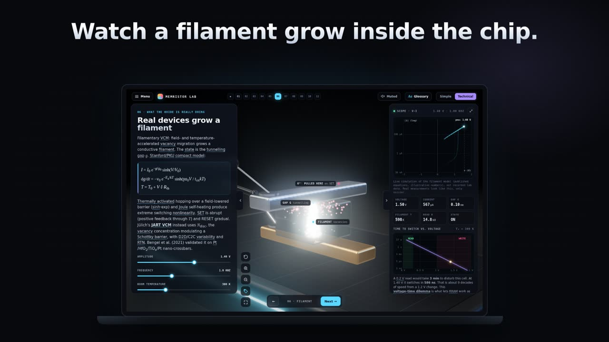

# Memristor Lab

**Live site: https://devonance.github.io/memristor-lab/**

**30-second tour video:** https://devonance.github.io/memristor-lab/media/tour.mp4

[](https://devonance.github.io/memristor-lab/media/tour.mp4)

An interactive 3D explainer of the memristor equation: what Chua predicted in 1971, what real devices do, the capacitor test, and why the ideal memristor still hasn't been found. It's built from the research brief *The Memristor Equation: What Has Been Tried, What Works, and Whether the Problem Is Solved* (Oct 2026).

- **12 stations.** These include a breadboard circuit with a black-box "M?" part, an LED, a button and a switch; a glass RRAM cell with a growing filament; HP's 2008 model and its window functions; a spiking NbO₂ device; the series-capacitor test; and the Φ-memristor story.
- **Simple / Technical switch.** Plain English for everyone, or the equations, models and references.
- **Definitions everywhere.** Every dotted word has a plain-English definition, and so does every part on the bench (tap its dot to open the label). There's also a searchable glossary.
- **Hands-on.** Drag on the scope to drive the voltage yourself. Press the button and flip the switch in 3D. Orbit the bench.
- **Music.** A seamless loop plays in the lab, with a mute button. The tour video has its own score.
- **Fast.** One static page with no external requests. The three.js stage is bundled and tree-shaken (~150 KB gzipped), and every texture is drawn at runtime. The music loads only once sound starts, and the video loads only when someone opens it.

## Layout
The site is served by GitHub Pages from the **`/docs`** folder on `main` (`docs/.nojekyll` is included).

## Edit the 3D bench
The source is `lab-src/stage3d.js` (three.js). Rebuild with:
```
cd lab-src && npm install && npm run build   # writes docs/js/stage.js
```
Everything else in `docs/js/` is plain, unbundled ES modules: `main.js` (stations), `models.js` (device physics), `plot.js` (scope), `glossary.js` (definitions).

## Credits
- Music: *The Glass Exhibit* (site theme) and *A Point of Clarity* (tour video), made by Kevin with Google Lyria, and cut to length and looped for this project
- 3D: [three.js](https://threejs.org) (MIT), bundled into `docs/js/stage.js`
